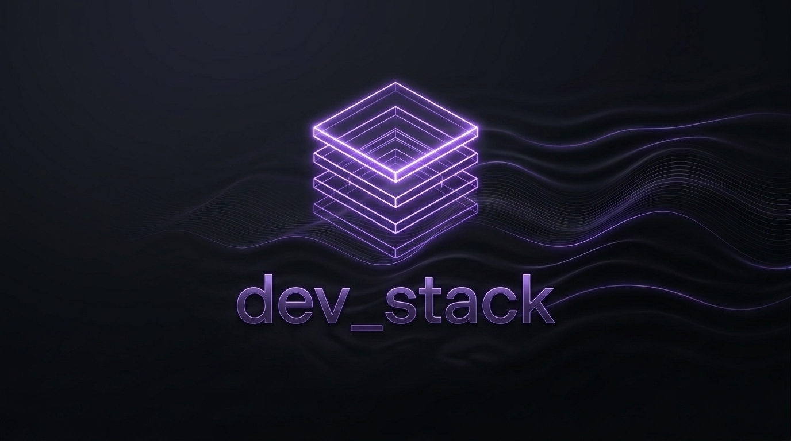

<div align="center">
  
  <br>
  <p><em>"Where disparate technologies constructively interfere into a unified developer flow."</em></p>
  <br>

  [](https://github.com/PrzemyslawSagalo/dev_stack/actions/workflows/ci.yml)
  [](https://github.com/PrzemyslawSagalo/dev_stack/security/code-scanning)
  [](https://pre-commit.com/)
  [](https://conventionalcommits.org)
  [](LICENSE)
  <br>
  [](https://github.com/PrzemyslawSagalo/dev_stack)
  [](https://docs.ansible.com/)
  [](https://neovim.io/)
  [](https://www.python.org/)
  [](https://www.docker.com/)
</div>

# Dev Stack

Automated, reproducible, and tested Linux development environment provisioning using Ansible.

Supports modern Linux distributions including **Ubuntu 24.04+** and **Amazon Linux 2023**.

---

## Quick Start

### 1. Fresh Machine Bootstrap (Zero Manual Setup)

On a clean Linux workstation or AWS EC2 instance:

```bash
curl -fsSL https://raw.githubusercontent.com/PrzemyslawSagalo/dev_stack/main/bootstrap.sh | bash
```

Alternatively, if you already cloned the repository:

```bash
chmod +x bootstrap.sh
./bootstrap.sh
```

### 2. Operational Shortcuts (Makefile)

The repository provides a [Makefile](Makefile) for managing common workflows. Run `make help` to view all available commands:

```bash
make help
```

### 3. Direct Ansible Execution

To run or re-apply the playbook directly:

```bash
ansible-playbook setup.yml
```

---

## What It Does & Why (Business Value)

`dev_stack` eliminates workstation setup friction by provisioning an identical, container-tested development environment in a single command:

| Capability | What It Provisions (What) | Business & Developer Value (Why) |
| :--- | :--- | :--- |
| **Runtimes & Compilers**<br>[`roles/system`](roles/system) | Multi-version Python (3.11–3.13 via `pyenv`), C++ (GCC/Clang/CMake), Java (Corretto 21), Go, Node.js. | **Zero build failures**: Pre-compiles all C-extension headers (`ssl`, `sqlite3`, `lzma`) so engineers never waste hours diagnosing missing libraries or version conflicts. |
| **Containers**<br>[`roles/system`](roles/system) | Docker CE engine + Docker Compose v2 with non-root group permissions. | **Immediate local execution**: Run containers without `sudo` privileges, guaranteeing dev/prod parity across workstations and cloud instances. |
| **Cloud & Cluster CLI**<br>[`roles/system`](roles/system) | AWS CLI v2, GitHub CLI (`gh`), Helm, OpenShift (`oc`) with pinned checksums. | **Instant cloud access**: Verified, cryptographically checked binary toolchains installed out of the box without manual setup steps. |
| **Terminal & Core CLI**<br>[`roles/system`](roles/system) | `tmux`, `ripgrep`, `fzf`, `fd`, `zoxide`, `bat`, `lazygit`, `tree-sitter`, `jq`, `yq`, `htop`, `try`, `direnv`, `uv` / `uvx`, `agy` (Google Antigravity). | **Maximum engineer velocity**: Instant fuzzy file/history search, smart directory jumping, syntax-highlighted previews, Git management, and AI agent coordination directly in persistent terminal sessions. |
| **Dotfiles & Shell**<br>[`roles/dotfiles`](roles/dotfiles) | Curated `.bash_aliases` (Git/venv helpers), vi-mode `.tmux.conf`, `~/.ssh/config`, `~/.gitconfig`, global gitignore (`~/.gitignore_global`). | **Zero muscle memory loss & secret leak prevention**: Identical shortcuts, navigation, and shell behavior across laptop, remote EC2 instances, and CI runners, with workstation-wide protection against committing `.envrc` and `.env` secret files. |
| **Editor (IDE)**<br>[`roles/nvim`](roles/nvim) | Hardened Neovim v0.12+ with LSP diagnostics, Treesitter, DAP debugging, and Copilot. | **Full headless IDE**: High-performance terminal editing and AI pair programming out of the box with zero manual plugin tinkering. |

---

## Fast Terminal Navigation (`fzf`, `fd`, `zoxide`, `bat`)

Modern CLI navigation primitives are provisioned and configured out of the box with zero setup:

| Tool | Universal Command & Aliases | Purpose & Key Shortcuts |
| :--- | :--- | :--- |
| **`fzf`** | `fzf` | Interactive fuzzy finder. Shell keybindings enabled: `Ctrl+R` (fuzzy command history search), `Ctrl+T` (fuzzy file discovery with `bat` preview), `Alt+C` (fuzzy directory change). |
| **`fd`** | `fd`, `fdfind` | Ultra-fast, `.gitignore`-aware alternative to `find`. Powers `FZF_DEFAULT_COMMAND` and `FZF_CTRL_T_COMMAND`. |
| **`zoxide`** | `zoxide`, `z`, `zi` | Smarter `cd` command tracking frequent directories. Jump instantly with `z <folder>` or interactive fuzzy jump with `zi`. |
| **`bat`** | `bat`, `batcat` | Syntax-highlighting `cat` clone with line numbers and Git integration. Powers `fzf` file previews during `Ctrl+T` fuzzy search. |

---

## Remote Clipboard (OSC 52)

- **macOS (iTerm2)**: Enable **Settings -> General -> Selection -> "Applications in terminal may access clipboard"** (disabled by default). Note that macOS built-in `Terminal.app` does not support OSC 52. Security tip: use a separate iTerm2 profile with clipboard access disabled when connecting to untrusted servers.
- **Windows (PowerShell in Windows Terminal)**: Run PowerShell inside **Windows Terminal** (supports OSC 52 natively; legacy `conhost.exe` does not) and paste from the local clipboard with `Ctrl+Shift+V`.
- **Usage (`tmux` & `nvim` over SSH)**:
  - `tmux`: Releasing a mouse drag copies to your local clipboard via OSC 52 and keeps the selection highlighted until the next click (`Cmd+V` / `Ctrl+Shift+V` to paste locally).
  - `nvim`: `y`/`yy` sends to your local clipboard via OSC 52, while `p` pastes from Neovim's internal cache (write-only OSC 52 avoids SSH/tmux paste hangs); hold `Shift` while dragging to copy directly via `tmux`.

---

## Project Environment Management (`direnv`)

`direnv` automatically loads and unloads environment variables when navigating into and out of project directories, eliminating manual `source .env`, export scripts, or accidental credential leaks.

### Security Model (`direnv allow`)

`direnv` checks authorization before loading any `.envrc` or `.env` file to prevent arbitrary code execution when cloning untrusted repositories:

- **First time entering a project directory**: `direnv` prompts that the `.envrc` is blocked.
- **Authorize loading**: Run `direnv allow` to grant execution permissions.
- **Revoke authorization**: Run `direnv deny` / `direnv block` if needed.
- **File modifications**: Any subsequent edit to `.envrc` requires re-authorization via `direnv allow`.

### Common `.envrc` Patterns

Create a `.envrc` file at your project root:

#### 1. Per-Project AWS & Cloud Context
```bash
# Pin AWS profile and region for this repository
export AWS_PROFILE=prod-analytics
export AWS_DEFAULT_REGION=eu-west-1
```

#### 2. Kubernetes Context & Namespace
```bash
# Set dedicated kubeconfig or namespace
export KUBECONFIG="$PWD/.kube/config"
export KUBE_NAMESPACE=dev-backend
```

#### 3. Automatic Python Virtual Environment
```bash
# Automatically activate local virtual environment
layout python3
# Or load existing venv
source_env_if_exists .venv/bin/activate
```

#### 4. Model Context Protocol (MCP) & API Tokens
```bash
# Load API tokens for MCP servers (e.g., Jira / Confluence)
export JIRA_INSTANCE_URL="https://yourcompany.atlassian.net"
export JIRA_API_TOKEN="your-secure-token"
```

---

## Atlassian MCP Integration (Jira & Confluence)

`dev_stack` configures out-of-the-box Model Context Protocol (MCP) support for Atlassian Jira and Confluence in [`roles/dotfiles/files/copilot/mcp-config.json`](roles/dotfiles/files/copilot/mcp-config.json) (mirrored to `~/.copilot/mcp-config.json` and `~/.gemini/config/mcp_config.json`).

### Execution Engine (`uv` & `uvx`)

The integration uses Astral's [`uv`](https://github.com/astral-sh/uv) and `uvx` toolchain installed at `/usr/local/bin` to execute pinned `mcp-atlassian==0.24.4` ephemerally without manual global package management.

### Required Environment Variables

Set the following environment variables in your environment (e.g., in `~/.bashrc` or exported before starting Copilot CLI / Antigravity) to enable communication with your Jira and Confluence instances:

| Environment Variable | Description | Example |
| :--- | :--- | :--- |
| `JIRA_URL` | Base URL of your Jira instance | `https://your-domain.atlassian.net` |
| `JIRA_USERNAME` | Jira account username or email address | `user@example.com` |
| `JIRA_API_TOKEN` | Jira Cloud API token | `<api-token>` |
| `CONFLUENCE_URL` | Base URL of your Confluence instance | `https://your-domain.atlassian.net/wiki` |
| `CONFLUENCE_USERNAME` | Confluence account username or email address | `user@example.com` |
| `CONFLUENCE_API_TOKEN` | Confluence Cloud API token | `<api-token>` |

---

## License

This project is licensed under the MIT License - see the [LICENSE](LICENSE) file for details.
